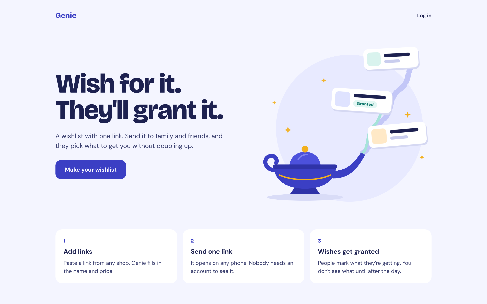
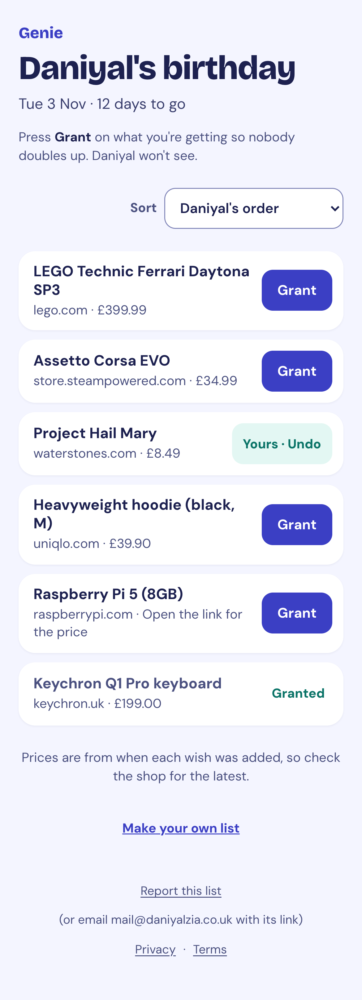
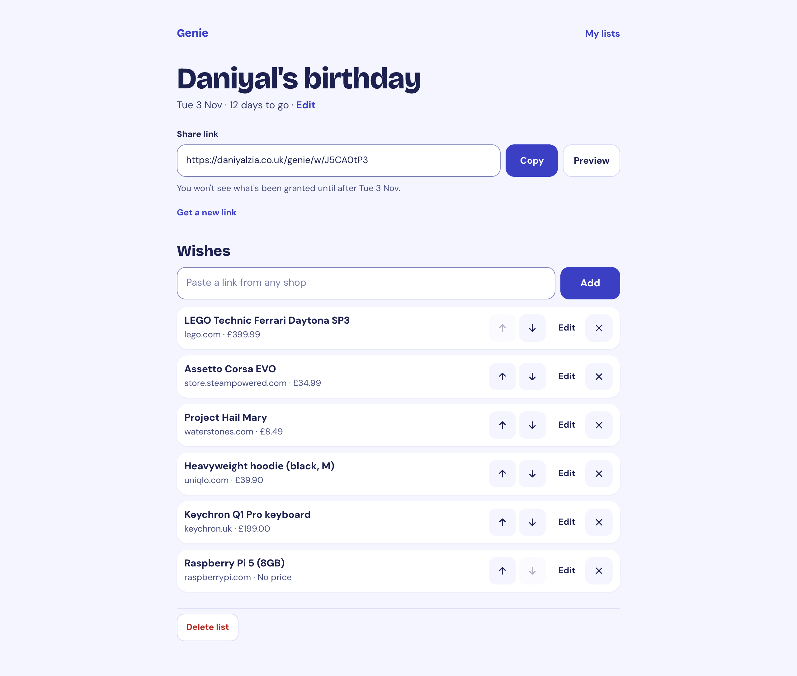

# Genie

**Wishlists with one share link.** Make a list of things you'd like, send one link to family and friends, and they pick what to get you. Visitors "grant" a wish so nobody buys the same thing twice, without needing an account. The list's owner only finds out what was granted after the day, and never who granted it.

Live at **[daniyalzia.co.uk/genie](https://daniyalzia.co.uk/genie/)**.



<table>
  <tr>
    <td width="34%"></td>
    <td></td>
  </tr>
  <tr>
    <td>What family see: a plain list, a Grant button, and what's already taken.</td>
    <td>What the owner sees: the share link and the wishes, but no grants until after the day.</td>
  </tr>
</table>

## How it works

1. **Add links.** Paste a link from any shop. Genie's fetcher (GenieBot) reads the page once for the product's name and price. Where a shop blocks it, the name comes from the link and the owner can fill in the rest. No shop pictures are copied: the link opens the shop's own page.
2. **Send one link.** `/genie/w/<code>` opens on any phone with no account. Visitors can sort by price.
3. **Wishes get granted.** A visitor taps Grant and confirms. Everyone else sees it's taken. Their browser keeps a private undo key, so only they can undo it. Grants hold no identity.
4. **The reveal.** From the day after the list's date, the owner sees which wishes were granted, and can reuse the list for next time.

## Under the hood

- **Client:** React 19 + Vite, plain CSS, self-hosted fonts.
- **Server:** TypeScript on plain `node:http` (run with tsx), with Postgres.
- **Shared:** `shared/` holds the types and limits both sides use.
- **Hosting:** a hardened systemd service (its own user, read-only sandbox) on a Proxmox container, behind nginx and a Cloudflare Tunnel.

**Security**
- **The link fetcher can't be pointed inward.** Every address is checked after DNS, including redirects, IPv6 forms, odd IPv4 spellings and the home's own public IP (followed through its DDNS name). Connections are pinned to the checked address. Size, time and per-account limits apply, and pages are read without a DOM parser.
- **Accounts:**
  - email + password, with emailed one-time codes (keyed hashes, 5 tries each, claimed atomically);
  - only hashes stored for sessions and trusted devices;
  - bcrypt, queued;
  - per-visitor rate limits that a stranger can't use to lock the owner out;
  - one answer whether or not an email has an account.
- **Browser:** a strict Content Security Policy (`'self'` only, no inline code), no referrer sent to shops, no cookies for visitors, no tracking or analytics.
- **Testing:** a security review attacked all of the above on local servers. Its findings were fixed and re-tested. The trade-offs it accepted are written down in [`PLAN.md`](PLAN.md).

**Privacy and safety:** the [privacy notice](https://daniyalzia.co.uk/genie/privacy) and [terms](https://daniyalzia.co.uk/genie/terms) are live. Online Safety Act records, the DPIA and how reports are handled are in [`docs/compliance/`](docs/compliance/). Every share page has a "Report this list" link.

## Running it locally

You need Node 22+ and a Postgres database you can reach. The server reads the standard `PGHOST` / `PGUSER` / `PGDATABASE` variables.

```bash
npm install
GENIE_DEV=1 npm run dev     # API on :3018, app on http://localhost:5186/genie/
```

`GENIE_DEV=1` turns on dev-only conveniences: emails are kept in memory and readable at `/genie/api/dev/mail?to=`, cookies aren't marked Secure, and the server refuses any database except one named `genie_dev`.

**Checks:**
- `npm run typecheck` and `npm run build`
- `cd server && npx tsx check-unfurl.ts`: the fetcher and page reading, no database needed
- `npm run check` and `cd server && npx tsx check-auth.ts`: end to end, against a dev database

[`PLAN.md`](PLAN.md) has the design, decisions and launch gates.

## Licence

MIT, see [LICENSE](LICENSE).
